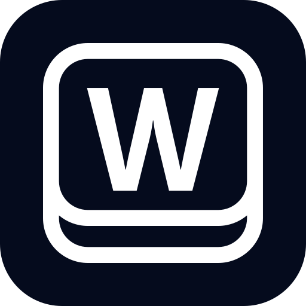

<p align="center">
  <a href="https://workspace369.com/"></a>
</p>

<h1 align="center">Workspace369 MCP server</h1>

<p align="center">
  The official remote <a href="https://modelcontextprotocol.io">Model Context Protocol</a> server for <a href="https://workspace369.com/">Workspace369</a>:<br>
  CRM, proposals, e-sign contracts, invoices, projects, calendar and time tracking for your AI apps.
</p>

<p align="center">
  <a href="https://glama.ai/mcp/connectors/com.workspace369/mcp"></a>
</p>

<p align="center">
  <a href="https://registry.modelcontextprotocol.io/v0/servers?search=com.workspace369/mcp"></a>
  
  
  <a href="LICENSE"></a>
</p>

<p align="center">
  <a href="https://cursor.com/install-mcp?name=workspace369&config=eyJ1cmwiOiJodHRwczovL21jcC53b3Jrc3BhY2UzNjkuY29tL21jcCJ9"></a>
</p>

---

Workspace369 is the all-in-one workspace for businesses that deliver client work: CRM, proposals, contracts and e-signature, invoices and payments, projects and tasks, calendar and booking, time tracking, a shared inbox and workflows.

Connect Claude, ChatGPT, Cursor, VS Code, Windsurf or any MCP client to your Workspace369 workspace. The AI app can then look up a client, draft an invoice or proposal, schedule work, log time or reply to a lead in plain language. Every call runs as you, within your own permissions.

```text
https://mcp.workspace369.com/mcp
```

- Transport: Streamable HTTP
- Auth: OAuth sign-in with your Workspace369 account (no API key to paste). Scripts and agents that can't open a browser use a [personal access token](https://docs.workspace369.com/v/2026.3/ai-connections/personal-access-tokens/).
- Hosted by Workspace369. Nothing to install or run locally.

This repository holds the public listing metadata ([`server.json`](server.json)) and connection docs. The server itself is operated by Workspace369 LLC and is not open source.

## Connect

**Claude (claude.ai, Desktop):** add a custom connector with the URL, then sign in.

**ChatGPT:** on plans that offer developer mode, add a custom connector (app) with the URL, then sign in.

**Cursor / Windsurf** (`mcp.json`):

```json
{
  "mcpServers": {
    "workspace369": {
      "url": "https://mcp.workspace369.com/mcp"
    }
  }
}
```

**VS Code** (`.vscode/mcp.json`):

```json
{
  "servers": {
    "workspace369": {
      "type": "http",
      "url": "https://mcp.workspace369.com/mcp"
    }
  }
}
```

**Claude Code:**

```sh
claude mcp add --transport http workspace369 https://mcp.workspace369.com/mcp
```

**VS Code (command line):**

```sh
code --add-mcp '{"name":"workspace369","type":"http","url":"https://mcp.workspace369.com/mcp"}'
```

When the app connects, Workspace369's sign-in page opens. Choose the workspace and set an access level for each area (None, View, Edit, Edit and send, and so on). The app never gets more than you approve. A workspace admin must first turn MCP on under Settings → AI Connections (MCP).

Full guide: [Connect an AI app to your workspace](https://docs.workspace369.com/v/2026.3/ai-connections/connect-an-ai-app-to-your-workspace/).

## What it can do

More than 100 tools across these areas ([full tools reference](https://docs.workspace369.com/v/2026.3/ai-connections/mcp-tools-reference/)):

| Area | Examples |
|---|---|
| Workspace | `workspace_get_context`, `workspace_schema`, `workspace_business_summary` |
| Clients and requests | `clients_search`, `clients_create`, `clients_move_stage`, `requests_search`, `requests_convert_to_client`, `requests_respond` |
| Proposals | `proposals_create_draft`, `proposals_update_draft`, `proposals_send` |
| Contracts | `contracts_create_draft`, `contracts_send`, `contracts_remind` |
| Invoices and payments | `invoices_create_draft`, `invoices_send`, `payments_record`, `invoice_payments_summary` |
| Projects and tasks | `projects_create`, `tasks_search`, `tasks_create`, `tasks_comment_add` |
| Calendar and booking | `calendar_list_events`, `calendar_create_event`, `calendar_check_availability`, `booking_pages_list` |
| Time tracking | `time_entries_create`, `time_entries_search`, `timesheets_list` |
| Inbox | `search_workspace_messages`, `inbox_send_message` |
| Workflows | `automations_list`, `automations_get`, `automations_test`, `automations_runs_list`, `automations_disable` |
| Notes, catalog, team, reminders | `notes_create`, `products_list`, `team_members_list`, `reminders_create` |

Some actions are deliberately left out and stay in the app: deleting clients, invoices, projects and other records, changing team members or permissions, creating, editing or turning on workflows, publishing intake forms, sending marketing campaigns and uploading files.

## Core CRM toolset (`/mcp/crm`)

A smaller address for apps and directories that work better with a focused tool list. It serves 21 tools from the same server: the same sign-in, scopes, permission checks, approval holds and rate limits as `/mcp`. It is a filtered view, not a separate product.

```text
https://mcp.workspace369.com/mcp/crm
```

- **Tools (21):** `workspace_get_context`, `workspace_schema`, `workspace_business_summary`, `clients_search`, `clients_get`, `clients_create`, `clients_update`, `clients_move_stage`, `notes_search`, `notes_get`, `notes_create`, `proposals_search`, `proposals_get`, `proposals_create_draft`, `invoices_search`, `invoices_get`, `invoices_create_draft`, `tasks_search`, `tasks_create`, `tasks_update`, `approvals_get`.
- **No send tools.** `approvals_get` is included because creating a proposal draft with an image link can be held for approval.
- **Prompts:** `set_up_my_crm`, `import_my_clients`, `weekly_pipeline_review`. `build_crm_frontend` stays on `/mcp`.
- **One workspace:** `https://mcp.workspace369.com/w/<workspaceId>/mcp/crm`. Use this form when you connect more than one workspace, and give each its own name (for example `workspace369-crm-acme`). Apps key a connection by its URL and name, so two workspaces on the shared address replace each other.
- **Same token:** a token or sign-in that works on `/mcp` works here.
- **Registry entry:** published separately as `com.workspace369/crm` (see [`crm/server.json`](crm/server.json)), so directories can show its 21 tools on their own. The full 118-tool server stays `com.workspace369/mcp`.

Claude Code:

```sh
claude mcp add --transport http workspace369-crm https://mcp.workspace369.com/mcp/crm
```

## Build a CRM with AI

Use Workspace369 as the backend when an AI coding agent builds your own CRM, client portal or dashboard. Your records, permissions and approvals stay in Workspace369, and the agent builds the screens.

- **Guide:** [Build a custom CRM with an AI coding agent](https://docs.workspace369.com/v/2026.3/build-with-ai/build-a-custom-crm-with-an-ai-coding-agent/)
- **Your app's server over HTTPS:** call the same MCP endpoint with a personal access token ([how](https://docs.workspace369.com/v/2026.3/build-with-ai/call-workspace369-from-your-app-over-https/)).
- **REST:** the [Builder API](https://docs.workspace369.com/v/2026.3/build-with-ai/call-workspace369-over-http-builder-api/) at `https://mcp.workspace369.com/v1` gives each resource its own URL and has an [OpenAPI spec](https://mcp.workspace369.com/v1/openapi.json). It's available on Specialist and higher.
- **Starter app:** [crm-starter](https://github.com/Workspace369-LLC/crm-starter) is a Next.js CRM template on Workspace369, with a sample-data mode that needs no account.
- **Ready-made calls:** see [`examples/`](examples/) for curl calls and client config files.

## Example prompts

- "Which invoices are overdue, and who owes the most?"
- "Draft a proposal for Acme for a website redesign using my catalog prices, but don't send it."
- "Log 2 hours today on the Acme project as billable."
- "What's on my calendar tomorrow, and is anyone on the team free at 3 pm?"
- "Find the latest email from Jane and draft a reply."

## Security and billing

- Each call is checked against your role's permissions. Members limited to specific clients see only those clients.
- Sends (invoices, proposals, inbox messages, contracts) need the matching "send" level you granted, and wait for approval in the Workspace369 app unless the person who connected the app turned on "send without asking".
- Calls draw on the workspace's monthly AI usage allowance; failed calls are free. See [How MCP access is controlled and billed](https://docs.workspace369.com/v/2026.3/ai-connections/mcp-permissions-tokens-and-audit/).
- The workspace owner is notified when someone connects an app, and connections can be revoked at any time.

## Listed in

- [Official MCP Registry](https://registry.modelcontextprotocol.io/v0/servers?search=com.workspace369/mcp) as `com.workspace369/mcp`
- [Glama](https://glama.ai/mcp/connectors/com.workspace369/mcp) (ownership verified)
- A public [server card](https://mcp.workspace369.com/.well-known/mcp/server-card.json) for crawlers that can't sign in

## Support and security

- Questions and bugs: [open an issue](https://github.com/Workspace369-LLC/workspace369-mcp/issues/new/choose) or email support@workspace369.com.
- Security reports: see [SECURITY.md](SECURITY.md). Please don't open public issues for vulnerabilities.
- Changes: [CHANGELOG.md](CHANGELOG.md).

## Links

- Website: https://workspace369.com/
- Docs: https://docs.workspace369.com/
- Pricing (14-day free trial): https://workspace369.com/pricing/
- iPhone app: https://apps.apple.com/us/app/workspace369/id6475013419
- Support: support@workspace369.com
- Trust center: https://workspace369.com/trust/

The files in this repository (listing metadata, docs and examples) are under the [MIT License](LICENSE). The Workspace369 service is operated by Workspace369 LLC under its [Terms of Service](https://workspace369.com/terms-of-service/).

© 2026 Workspace369 LLC.
